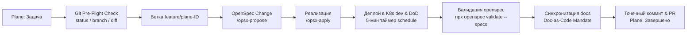

# Конституция и Стандарты Разработки для AI-Ассистентов — Экосистема SmartBet.guru

Этот документ является **единым обязательным сводом правил (Single Source of Truth)** для всех AI-ассистентов (Google Antigravity, локальные агенты, автономные воркеры Plane в K8s) во всех репозиториях экосистемы: бэкенде, фронтенде и спецификациях.

---

## 📌 1. Архитектура OpenSpec и Живые Спецификации

Проект функционирует строго по стандарту **OpenSpec (Spec-Driven Development)**.
Центральный репозиторий спецификаций и архитектурной документации: [`datawikipro/igaming-openspec`](https://github.com/datawikipro/igaming-openspec.git).

### Живые спецификации возможностей:
- [`crawler-engine`](file:///c:/Users/chernousov_a/IdeaProjects/igaming-openspec/openspec/specs/crawler-engine/spec.md) — краулеры 52 букмекеров, stealth-профили, стриминг Kafka.
- [`aggregator-core`](file:///c:/Users/chernousov_a/IdeaProjects/igaming-openspec/openspec/specs/aggregator-core/spec.md) — нормализация, расчет вилок / +EV / коридоров в памяти, PostgreSQL.
- [`portal-gateway`](file:///c:/Users/chernousov_a/IdeaProjects/igaming-openspec/openspec/specs/portal-gateway/spec.md) — API Gateway, JWT, тарифы, REST/WS.
- [`frontend-architecture`](file:///c:/Users/chernousov_a/IdeaProjects/igaming-openspec/openspec/specs/frontend-architecture/spec.md) — Next.js 14/15, React Native Mobile, Chrome Extension.
- [`k8s-infrastructure`](file:///c:/Users/chernousov_a/IdeaProjects/igaming-openspec/openspec/specs/k8s-infrastructure/spec.md) — K3s кластер, K8s DNS (запрет IP), HikariCP, Jib, прокси.
- [`social-media-bot`](file:///c:/Users/chernousov_a/IdeaProjects/igaming-openspec/openspec/specs/social-media-bot/spec.md) — SMM-агенты, Redroid Android-ферма, 1:1 прокси, дисклеймеры.
- [`verification-and-dod`](file:///c:/Users/chernousov_a/IdeaProjects/igaming-openspec/openspec/specs/verification-and-dod/spec.md) — Definition of Done, 5-минутный таймер, Repair Protocol.
- [`plane-ai-workflow`](file:///c:/Users/chernousov_a/IdeaProjects/igaming-openspec/openspec/specs/plane-ai-workflow/spec.md) — воркеры Plane, очереди K8s, обратные вызовы и артефакты.

### Базовая архитектурная документация:
- 🌐 [Сетевая карта и прокси-шлюзы (Network & Proxy Mesh)](file:///c:/Users/chernousov_a/IdeaProjects/igaming-openspec/docs/architecture/network-and-proxy-mesh.md)
- 🎮 [Nintendo Switch, персональные смартфоны и обход РКН](file:///c:/Users/chernousov_a/IdeaProjects/igaming-openspec/docs/architecture/nintendo-switch-and-personal-devices.md)
- 📱 [SMM-персоны, циркадный ритм и SIM-шлюз Xiaomi 12T Pro](file:///c:/Users/chernousov_a/IdeaProjects/igaming-openspec/docs/architecture/smm-personas-and-sim-gateway.md)
- 💻 [Enterprise-регламент синхронной документации и 2 ноутбука](file:///c:/Users/chernousov_a/IdeaProjects/igaming-openspec/docs/workflows/enterprise-doc-sync-and-multi-laptop.md)

---

## 📚 2. Закон Синхронной Документации (Doc-as-Code Mandate)

> **КОД БЕЗ ДОКУМЕНТАЦИИ — НЕЗАВЕРШЁННЫЙ ДЕФЕКТ.**
> Запрещено переводить задачу в Plane в статус `Завершено`, пока соответствующие изменения не внесены в документацию и OpenSpec в том же коммите.

1. **Изменение сетевых маршрутов, портов, подов или прокси** $\rightarrow$ обновить [`network-and-proxy-mesh.md`](file:///c:/Users/chernousov_a/IdeaProjects/igaming-openspec/docs/architecture/network-and-proxy-mesh.md) и `k8s-infrastructure/spec.md`.
2. **Изменение логики краулеров / парсеров** $\rightarrow$ обновить `crawler-engine/spec.md`.
3. **Изменение поведения SMM или 2FA шлюзов** $\rightarrow$ обновить [`smm-personas-and-sim-gateway.md`](file:///c:/Users/chernousov_a/IdeaProjects/igaming-openspec/docs/architecture/smm-personas-and-sim-gateway.md).
4. **Валидация спецификаций перед закрытием**: обязательный запуск `npx --yes openspec validate --specs` (все спецификации обязаны иметь статус `passed`).

---

## ✈️ 3. Жизненный Цикл Задачи (Plane + OpenSpec Workflow)



1. **Git Pre-Flight Check**: проверка перед стартом (`git status -s`, `git branch --show-current`, `git log -n 5 --oneline`, `git diff --stat`).
2. **Инициализация**: создание изолированной ветки `feature/plane-<ID>` (или `feature/laptop2-<ID>`) и предложения `openspec/changes/<ID>/`.
3. **Реализация**: код строго по дельта-спецификациям и чеклисту `tasks.md`.
4. **Верификация**: проверка Definition of Done в K8s namespace `igaming-dev`.
5. **Валидация и документация**: прогон `openspec validate --specs` и обновление `docs/`.
6. **Закрытие**: точечный коммит файлов своей задачи, создание PR, архивация OpenSpec и перевод задачи в Plane в статус **`Завершено`**.

---

## 🏆 4. Непреложные Правила (Golden Rules)

### 1. 🛡️ Definition of Done & 5-минутный сторожевой таймер (`schedule`)
- Под задеплоен в Kubernetes namespace `igaming-dev` в статусе `Running 1/1`.
- Actuator пробы `/actuator/health/readiness` и `liveness` возвращают HTTP 200 `UP`.
- **СТРОГИЙ ЗАПРЕТ**: запрещено закрывать задачу, пока под не отработает **5 ПОЛНЫХ МИНУТ** без ошибок в логах. При ожидании агент **ОБЯЗАН установить таймер через `schedule`** на оставшееся время.

### 2. 🚫 Запрет IP-адресов — Только K8s DNS Service Names!
- **Категорически запрещено** хардкодить IP-адреса в коде микросервисов, K8s-манифестах или конфигах.
- Использовать только имена сервисов (например: `igaming-source-winline-db`, `de-proxy.proxy`, `cluster-switch-proxy.proxy`).

### 3. 🛠️ Протокол Авторемонта (Repair Protocol)
- Если базовый модуль сломан (`CrashLoopBackOff`, битая БД), **запрещено** писать фичу поверх него.
- Текущая задача приостанавливается, создается задача `[REPAIR] Восстановление модуля <module>` на ветке `fix/<module>`, база восстанавливается до зеленого статуса, затем продолжается разработка.

### 4. 🔍 Git Pre-Flight Check & Защита от Коллизий (Multi-Laptop & AI Safety)
- **СТРОЖАЙШИЙ ЗАПРЕТ на деструктивные команды**: категорически запрещены `git reset --hard`, `git checkout -- .`, `git clean -fd`, `git push --force`.
- **Запрет слепых коммитов**: запрещено использовать `git add .` или `git add -A`. Индексировать **только конкретные файлы своей задачи** (`git add <file1> <file2>`).
- **Изоляция веток**: ноутбук 1 (`laptop1/*`), ноутбук 2 (`laptop2/*`), ИИ-воркеры (`feature/plane-*`). Не переключать ветки поверх незакоммиченных изменений других агентов.

### 5. 🎯 Запрет на Отбрасывание Аномалий (Zero Outlier Discard Policy)
- **Проблемы мы НЕ отбрасываем, а ПОКАЗЫВАЕМ тестировщикам!**
- **Категорически запрещено** внедрять в `aggregator-*` алгоритмы слепого отбрасывания котировок или аномальных вилок (20%+, 50%+).
- При обнаружении аномалии единственно верное действие — исследовать фид и исправить парсер конкретного букмекера (`igaming-source-*`).

### 6. 📊 Критерий Наполнения Линии (Threshold >= 500 матчей)
- Задача по любому букмекеру считается выполненной **ТОЛЬКО** при наполнении линии от **500 активных матчей** (`SELECT count(*) FROM match_cache >= 500`). Статус `Running 1/1` при 0 матчей — незавершённый дефект.

### 7. ⚡ Неблокирующий старт HikariCP / JPA и Сборка Jib
- В `application.properties` обязательны:
  ```properties
  spring.datasource.hikari.initialization-fail-timeout=0
  spring.datasource.hikari.connection-timeout=5000
  spring.datasource.hikari.validation-timeout=3000
  spring.jpa.properties.hibernate.temp.use_jdbc_metadata_defaults=false
  ```
- В PowerShell все параметры с точками берутся в двойные кавычки: `mvn.cmd -pl <module> jib:build "-Djib.to.image=..." -DskipTests`.

### 8. 🌐 Сетевая Топология и Выделенные Прокси
- **РФ-букмекеры (ЦУПИС/ЕРАИ) и боты ВКонтакте**: `direct` через домашний IP СПб `188.242.33.93` (`ru-proxy`, `100.83.113.50`).
- **Европейские/оффшорные букмекеры, LLM API, Telegram Bot API**: `http://de-proxy.proxy.svc.cluster.local:3128` (`de-proxy-1`, Франкфурт, `100.111.55.54`).
- **Nintendo Switch и личные смартфоны**: шлюз `http://cluster-switch-proxy.proxy.svc.cluster.local:3128` (апстрим переключается между DE, RU и Orion).
- **SMM-соцсети (Instagram, Threads, Reddit)**: статические прокси 1:1 из пула `purevpn-*` (квота 8/10), виртуальные телефоны Redroid (порты 5555+), приём 2FA через WhatsApp/SMS шлюз Xiaomi 12T Pro (`+79137671550`).
- **Синхронизация между ноутбуками**: локальное зеркало на хосте Xeon: `ssh://root@100.78.183.101/data/git-mirror/`.
