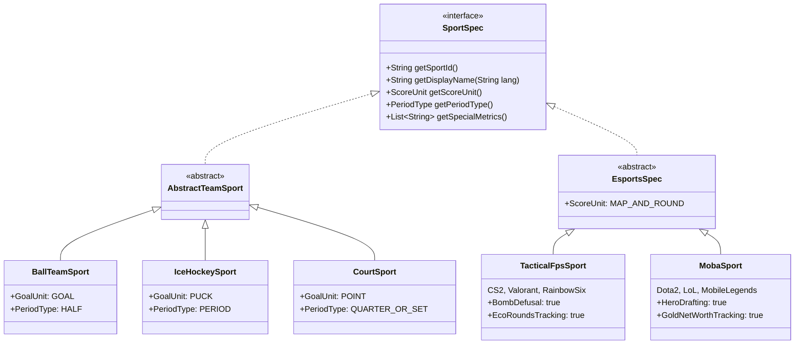

# 🧠 Архитектурная Конституция: Анализ Матчей, Team DNA и Генерация Нарративов
## Модули: `aggregator-enrichment`, `igaming-dto`, `igaming-capture-sofascore`

Этот документ фиксирует архитектурные решения, математическую концепцию, модель данных и правила разработки подсистемы матчевого анализа экосистемы **SmartBet.guru**.

---

## 🏛️ 1. Фундаментальные Принципы (Core Principles)

### 1.1. Zero-Odds Protocol (Слепой Анализ)
- **Изоляция от котировок**: При тактическом анализе матча AI-модель и статистические оценщики (`TeamDnaEngineService`, Dixon-Coles, Pace/Possession models) **НЕ должны иметь доступа к коэффициентам букмекеров**.
- **Защита от «отравления котировками» (Odds Anchoring)**: Если модель заранее видит кэф 1.15 на фаворита, она подсознательно ищет аргументы в пользу разгрома. В «слепом» режиме модель опирается исключительно на спортивные метрики: xG, xGA, PPDA, темп владений, травмы ключевых игроков (например, отсутствие диспетчера/плеймейкера), фактор домашнего поля и тактический стиль (низкий блок vs высокий прессинг).
- **Выявление Alpha (+EV)**: Истинный перевес возникает в дельте между «справедливой вероятностью» слепой модели ($P_{fair}$) и подразумеваемой вероятностью рынка ($P_{market} = 1 / Odds$).

### 1.2. Концепция Синтетических Вилок и Опережения Рынка
- **Суть явления**: Букмекеры и толпа игроков («подпивасы») часто формируют линию по инерции бренда (переоценка медийных клубов вроде МЮ, Барселоны, Челси) или по поверхностным средним числам («обе забьют», верховые тоталы).
- **Синтетическая вилка (Market Inefficiency Anticipation)**: Зафиксировав тактическое несоответствие до матча, мы понимаем, что после стартового свистка реальный рисунок игры (например, глухая защита андердога или вязкий хоккей) станет очевиден зрителям у экрана, и рынок начнет стремительно проседать в сторону справедливой котировки.
- **Действие**: Подсвечивать в API и на витрине коэффициентов потенциальные неоптимальности линии («потенциальный разворот рынка»), а в блогах и сторибордах давать аргументированное объяснение для ранней фиксации выгодной позиции.

### 1.3. Табу на Синтетические Матчи при Валидации (Ground Truth Policy)
- **СТРОЖАЙШИЙ ЗАПРЕТ**: При тестировании, отладке и бенчмарках моделей **категорически запрещено выдумывать или генерировать синтетические матчи** («Лион — Бешикташ», если их нет в текущей линии).
- **Единственный источник правды**: Все проверки проводятся **ТОЛЬКО** по реальным записям из базы данных:
  - `match_record` и `odds_actual` — актуальные линии и котировки.
  - `team_match_history` и `sofascore_raw_events` — подтвержденные завершенные матчи и протоколы.

---

## 🧬 2. Архитектура Team DNA и Match Context Tags

### 2.1. Bi-Temporal Match Ledger (`team_match_history`)
Для расчета профилей команд нельзя использовать просто инкрементальный счетчик в памяти.
- История каждого матча сохраняется как неизменяемая запись леджера с полями:
  - `team_id`, `sport`, `match_date`, `opponent_id`, `is_home`
  - `scored`, `conceded`, `xg_for`, `xg_against`, `possession`, `shots_on_target`
  - `raw_stats_json` (полный дамп специфичных метрик)
- Индекс: `(sport, team_id, match_date DESC)`.

### 2.2. Профиль Team DNA (`team_dna_profile`)
Вычисляется скользящим окном по последним $N$ матчам (по умолчанию $N = 10, 20$):
- **Стиль игры**: `POSSESSION_DOMINANT`, `LOW_BLOCK_COUNTER`, `HIGH_PRESS_CHAOS`, `BALANCED`.
- **Фактор поля**: Home Advantage Multiplier (процент побед дома vs в гостях).
- **Тренды тоталов**: Over/Under Tendency (% матчей на ТБ 2.5 / ТМ 2.5).
- **Серии**: Текущий стрик побед/поражений, сухих матчей.
- **Уязвимости**: Зависимость от конкретных игроков, уязвимость к стандартам.

### 2.3. Контекстные Теги Матча (`MatchContextTag`)
На основе сопоставления DNA обеих команд генерируются теги контекста:
- Базовые: `NEUTRAL_VENUE`, `DERBY`, `RELEGATION_BATTLE`, `TITLE_DECIDER`, `FATIGUE_BACK_TO_BACK`.
- Стилистические: `CLASH_OF_STYLES` (владение против контратаки), `UNDERDOG_WALL` (низкий блок фавориту).
- Киберспортивные:
  - `MAP_POOL_VULNERABLE` (уязвимость к банам карт соперника).
  - `DRAFT_DEPENDENT` (критическая зависимость команды от драфта/пика героев в MOBA).

---

## 🏆 3. ООП-Иерархия Видов Спорта (Sports OOP Hierarchy)

Вместо плоских `enum` с километровыми `switch-case` и процедурными заплатками (`getDisplayNameRu()`), спортивная логика строится на принципах чистой объектно-ориентированной архитектуры:

### 3.1. Запрет псевдомаппинга дисциплин
- **СТРОГО ЗАПРЕЩЕНО** регистрировать `mobile_legends -> CS2` или `rainbow_six -> DOTA2`.
- Киберспортивные дисциплины строго делятся на семейства:
  - **Tactical FPS**: CS2, Valorant, Rainbow Six Siege (карты, раунды, сторона атаки/защиты, бай-раунды).
  - **MOBA**: Dota 2, League of Legends, Mobile Legends: Bang Bang (драфт героев, линии, башни, нетворс, Рошан/Барон).

---

## 📜 4. Комбинаторный Генератор Нарративов (`CombinatorialNarrativeGenerator`)

### 4.1. Многоязычность без `if-else`
- Локализация реализуется через паттерн **Strategy** (`NarrativeStrategy`):
  - `RussianNarrativeStrategy`, `EnglishNarrativeStrategy`, `FrenchNarrativeStrategy`, `GermanNarrativeStrategy`, `SpanishNarrativeStrategy`.
- Регистрация стратегий в `Map<String, NarrativeStrategy>`:
  - `generator.getStrategy(langCode)` — вызов $O(1)$.

### 4.2. Сборка сториборда
- Нарратив формируется слоями:
  1. **Интро**: статус турнира, важность очков, мотивация (дерби, плей-офф).
  2. **Стилистический конфликт**: пересечение тегов DNA обеих команд (напр., «Хозяева навязывают высокий темп, но гости выстроят двойной автобус»).
  3. **Специфика дисциплины**: шайбы/периоды для хоккея, пики/маппул для CS2/Dota 2.
  4. **Математический вывод (Alpha Insight)**: указание на перекос линии букмекеров без называния конкретных цифр кэфов, фокус на вероятностный исход.

---

## 🗄️ 5. Сбор Данных и Dual-Storage (SofaScore & Kafka)

### 5.1. Поток Событий
1. Краулер [`igaming-capture-sofascore`](file:///c:/Users/chernousov_a/IdeaProjects/igaming/igaming-capture-sofascore) забирает данные:
   - Сырой JSON сохраняется в таблицу `sofascore_raw_events` (`event_id`, `sport`, `event_date`, `payload_json`, `created_at`).
   - Событие публикуется в Kafka топик `igaming.sofascore.raw-events`.
2. Сервис [`aggregator-enrichment`](file:///c:/Users/chernousov_a/IdeaProjects/igaming/aggregator-enrichment) читает топик:
   - Парсит спортивные сущности в `team_match_history`.
   - Обновляет скользящий `team_dna_profile`.
   - Пересчитывает сториборд матча.

### 5.2. Сетевой Доступ и Обход 403 Forbidden
- **Проблема**: `api.sofascore.com` использует защиту Varnish / Cloudflare с фильтрацией TLS-фингерпринтов (JA3/JA4) и датацентровых IP. Прямые HTTP-запросы из JVM на серверах получают `403 Forbidden`.
- **Решение**:
  - Использование локального пула прокси кластера (`cluster-switch-proxy.proxy:3128`, `ru-proxy`, `de-proxy-1:3128`).
  - Передача набора заголовков браузерного профиля: `User-Agent`, `sec-ch-ua`, `sec-ch-ua-mobile`, `sec-ch-ua-platform`, `Referer: https://www.sofascore.com/`, `Origin: https://www.sofascore.com`.
  - При необходимости тяжелого сбора архивов — использование легковесного headless-воркера (Chromium / curl-impersonate).

---

## 📋 6. План Доработок и Бэклог

1. **[TASK-ENRICH-01] SofaScore Proxy Connector & 2-Year Historical Ingestion**:
   - Настройка HTTP-клиента с поддержкой upstream-прокси и browser-like headers.
   - Скрипт бэкфилла за 2024–2026 годы для футбола, хоккея, тенниса и CS2/Dota2.
2. **[TASK-ENRICH-02] Real Line +EV Scanner & Market Reversal Anticipation**:
   - Джойн актуальных котировок `odds_actual` с `team_dna_profile` и `MatchContextTag`.
   - Экспонирование эндпоинта `/api/v1/enrichment/insights/active-matches` для веб-портала.
3. **[TASK-ENRICH-03] Esports Narrative & Discipline Specialization**:
   - Полноценное разделение `TacticalFpsSport` vs `MobaSport` в `igaming-dto` и `aggregator-enrichment`.
   - Добавление тегов `DRAFT_DEPENDENT` и `MAP_POOL_VULNERABLE` в `MatchContextTag` и генератор историй.

---

## 🛡️ 7. Протокол Проверки Стартовых Составов и Стресс-Тест «Все Плохо / Улитки» (Kickoff & Worst-Case Floor)

### 7.1. Kickoff In-Play Lineup Verification (`WAIT_KICKOFF` $\rightarrow$ `KICKOFF_VERIFIED`)
- **Проблема слепых предматчевых ставок**: В кубковых и минорных лигах (Serie C Cup, резервные первенства, региональные кубки) электронные стартовые протоколы часто не публикуются заблаговременно ($T-45$m). Доверять прогнозируемым составам на слепую чистую победу фаворита недопустимо — тренеры выпускают резервистов, и матч завершается вязкой нулевой ничьей (0:0).
- **Протокол ожидания свистка (`WAIT_KICKOFF`)**:
  - Если за $T \le 45$ минут до матча электронный протокол отсутствует (`is_lineup_confirmed == false`), система переводит рекомендацию в статус ожидания `WAIT_KICKOFF` (`resultStatus = WAITING`).
  - Ставка до свистка **блокируется**.
- **Верификация на 1-й минуте (`KICKOFF_VERIFIED`)**:
  - На 0–2 минутах после стартового свистка скауты и арбитры фиксируют реальных футболистов, коснувшихся мяча на газоне.
  - Воркер `scanKickoffInPlayMatches` (интервал 30с) проверяет живой протокол при счете 0:0. Котировки в первую минуту практически идентичны предматчевым (98–99%), но неопределенность состава сведена к 0.
  - При подтверждении боевого состава ставка активируется со статусом `KICKOFF_VERIFIED`. Если за 5 минут протокол не появился — автоматический `PASS` (`SKIPPED`).

### 7.2. Стресс-Тест «Все Плохо / Улитки» (Worst-Case Floor & Adversarial Rotation)
- **От идеальной формы к худшему сценарию**: Классический сценарий «ЕСЛИ выйдут все лидеры в идеале — фаворит победит» часто разбивается о реальность. Новый алгоритм `worst_case_floor` симулирует ветку максимальной лени («все плохо»):
  - Резервисты фаворита пешком перекатывают мяч без мотивации.
  - Соперник выстраивает глубокий «автобус» на ничью.
- **Математические метрики устойчивости**:
  $$P_{\text{worst\_win}} = \min_{b \in \text{scenarios}} P(\text{Win}_b)$$
  $$\Delta_{\text{fragility}} = \frac{P_{\text{base\_win}} - P_{\text{worst\_win}}}{P_{\text{base\_win}}} \times 100\%$$
- **Критерий хрупкости фаворита (Adversarial Snail-Pace Guard)**:
  - Если $P_{\text{worst\_win}} < 48\%$ или просадка $\Delta_{\text{fragility}} \ge 16\%$, фаворит признается **хрупким** (`is_fragile = true`).
  - **Автоматическое купирование чистых побед**: модель блокирует голые ставки `WIN1` / `WIN2` и принудительно переключает рекомендацию на двойной шанс `DOUBLE_CHANCE_1X` / `DOUBLE_CHANCE_X2`, гарантируя сохранность банка при ничьей 0:0 или 1:1.
