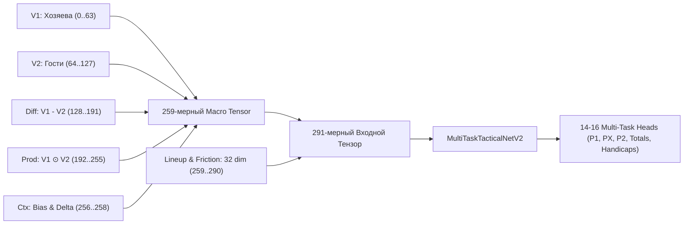

# 📐 Канонический Контракт 291-мерного Тактического Тензора (Single Source of Truth)

**Статус:** Действующий институциональный стандарт  
**Модель:** `MultiTaskTacticalNetV2`  
**Среда исполнения:** Java (сборка признаков перед инференсом) + Python PyTorch (обучение и инференс на :8085)  
**Инвариант:** Любое изменение структуры тензора в Java (`TacticalTensorBuilder.java`) или Python (`prepare_multitask_matrix.py`, `ml_inference_service.py`) обязано строго следовать этому контракту во избежание **Feature Drift**.

---

## 🏗️ Архитектура Тензора (291 признак)

$$X \in \mathbb{R}^{291} = \Big[ \underbrace{V_{\text{Team1}}}_{64} \ \Big\Vert \ \underbrace{V_{\text{Team2}}}_{64} \ \Big\Vert \ \underbrace{\Delta(V_1 - V_2)}_{64} \ \Big\Vert \ \underbrace{\Pi(V_1 \odot V_2)}_{64} \ \Big\Vert \ \underbrace{C_{\text{Context}}}_{3} \ \Big\Vert \ \underbrace{L_{\text{Lineup\&Friction}}}_{32} \Big]$$

---

## 1. Структура 64-мерного вектора команды ($V_1$ [0..63] и $V_2$ [64..127])

### 📊 Блок 1: Макро-результаты и Байесовская форма (Dims 0..7)
*Расчет: Байесовское сжатие Дирихле-Мультиномиального распределения на истории последних матчей.*
- **Dim 0**: `win_rate` — Байесовская вероятность победы: $(W + 4 \times 0.45) / (N + 4)$.
- **Dim 1**: `draw_rate` — Вероятность ничьей: $(D + 4 \times 0.28) / (N + 4)$ (для видов спорта с ничьими; 0.0 для тенниса).
- **Dim 2**: `loss_rate` — Вероятность поражения: $(L + 4 \times 0.27) / (N + 4)$.
- **Dim 3**: `goals_for_norm` — Забитые голы в среднем / 3.0.
- **Dim 4**: `goals_against_norm` — Пропущенные голы в среднем / 3.0.
- **Dim 5**: `goal_diff_norm` — Разница голов в среднем / 3.0.
- **Dim 6**: `clean_sheet_rate` — Доля матчей на ноль обороны.
- **Dim 7**: `failed_to_score_rate` — Доля матчей без забитых голов атаки (или фактор дней отдыха для тенниса).

---

### 🛡️ Блок 2: Устойчивость и управление сценарием (Dims 8..17)
*Источник: ClickHouse DDS `match_gamestate_resilience_fact`.*
- **Dim 8**: `conceded_first_rate` — Частота первого пропущенного гола (априорное 0.48).
- **Dim 9**: `comeback_equalize_rate` — Способность отыграться до ничьей при отставании (априорное 0.32).
- **Dim 10**: `comeback_win_rate` — Способность вырвать победу на морально-волевых (априорное 0.16).
- **Dim 11**: `ppg_losing` — Очки за матч при отставании в счете (априорное 0.22).
- **Dim 12**: `collapsed_lead_rate` — Частота упущенного преимущества (ведущие в счете, но отдавшие победу, априорное 0.18).
- **Dim 13**: `blown_lead_points` — Потерянные очки из выигрышного положения (априорное 0.25).
- **Dim 14**: `clean_sheet_rate_fact` — Фактический сухой рейтинг из DDS (априорное 0.28).
- **Dim 15**: `failed_to_score_rate_fact` — Фактический атакующий провал из DDS (априорное 0.24).
- **Dim 16**: `avg_max_deficit` — Средний максимальный дефицит в счете (априорное 0.45).
- **Dim 17**: `late_goals_scored_ratio` — Доля голов после 75-й минуты: $G_{75+} / (G_{75+}^{\text{for}} + G_{75+}^{\text{against}})$ (априорное 0.21).

---

### ⏱️ Блок 3: 15-минутное распределение голов/событий (Dims 18..29)
*Источник: ClickHouse DDS `match_goal_timeline_fact` (6 интервалов: 1-15, 16-30, 31-45, 46-60, 61-75, 76+).*
- **Dims 18..23**: Доля забитых голов по 15-минутным интервалам $b_1..b_6$ (априорное 0.166).
- **Dims 24..29**: Доля пропущенных голов по 15-минутным интервалам $b_1..b_6$ (априорное 0.166).

---

### 🎯 Блок 4: Продвинутые тактические метрики xG и давления (Dims 30..47)
*Источник: ClickHouse DDS `football_match_fact` / `tennis_match_fact`.*
- **Dim 30**: `avg_xg_for` — Ожидаемые голы xG (нормализовано / 4.0).
- **Dim 31**: `avg_xg_against` — Ожидаемые пропущенные xGA (нормализовано / 4.0).
- **Dim 32**: `xg_diff` — Разница xG ($0.50$ = нейтрально).
- **Dim 33**: `conversion_fragility` / `xg_over_for` — Разрыв между xG и реальными голами.
- **Dim 34**: `shot_blocking_rate` / `xg_over_against` — Оборонительный блок ударов.
- **Dim 35**: `open_play_xg_ratio` — Доля xG с игры ($0.75$).
- **Dim 36**: `set_piece_xg_ratio` — Опасность стандартов ($0.25$).
- **Dim 37**: `ppda` — Интенсивность прессинга (Passes Allowed Per Defensive Action / 30.0).
- **Dim 38**: `def_line_height` — Высота линии обороны ($0.50$).
- **Dim 39**: `possession` — Процент владения мячом / 100.0.
- **Dim 40**: `pass_accuracy_pct` — Точность передач ($0.80$).
- **Dim 41**: `rest_defense_solidity` / `prog_passes` — Структура защиты при потере мяча.
- **Dim 42**: `openness_gradient` / `sca` — Частота матчей $\ge 4$ голов (Shot Creating Actions).
- **Dim 43**: `under_rate` / `gca` — Частота матчей $\le 2$ голов (Goal Creating Actions).
- **Dim 44**: `aerial_won_pct` — Доля выигранных верховых единоборств.
- **Dim 45**: `fouls` — Интенсивность фолов (фолы / 25.0).
- **Dim 46**: `cards` — Склонность к карточкам (ЖК / 6.0).
- **Dim 47**: `first_half_diff` / `slam_tier` — Перевес в первом тайме / ATP Slam Tier.

---

### 🧬 Блок 5: Возраст и биологическая динамика состава (Dims 48..51)
*Источник: ClickHouse DDS `football_lineup_player_fact`.*
- **Dim 48**: `avg_starter_age` — Средний возраст старта: $(\text{Возраст} - 18) / 22$.
- **Dim 49**: `young_pct` — Доля молодежи ($\le 22$ лет).
- **Dim 50**: `veteran_pct` — Доля ветеранов ($\ge 32$ лет).
- **Dim 51**: `age_std` — Стандартное отклонение возраста состава / 10.0.

---

### 🏆 Блок 6: Турнирная Мотивация и Point-in-Time Динамика (Dims 52..58)
> ⚠️ **КРИТИЧЕСКИЙ СТАНДАРТ:** Эти размерности строго зафиксированы за турнирными мотивационными ставками и ликвидируют рассинхрон между обучением и боевым инференсом!

#### Для командных видов спорта (Футбол, Баскетбол, Хоккей, Esport):
- **Dim 52**: `elimination_pressure` — Индекс давления плей-офф/вылета ($1.0$ = матч на вылет / финал, $0.5$ = группа, $0.0$ = регулярка).
- **Dim 53**: `draw_viability` — Допустимость ничейного исхода ($0.0$ = серия пенальти/овертайм, $1.0$ = регулярный тур).
- **Dim 54**: `regional_card_bias` — Региональный темперамент лиги ($0.85$ = Лат. Америка / Турция, $0.30$ = Скандинавия / Япония).
- **Dim 55**: `blowout_gradient` — Градиент необходимости крупной победы (разница голов при тай-брейке).
- **Dim 56**: `win_leverage` — Турнирная цена победы (Win Leverage).
- **Dim 57**: `elimination_hazard` — Угроза вылета из дивизиона / турнира.
- **Dim 58**: `prize_wage_ratio` — Финансовый мультипликатор призовых турнира к фонду оплаты труда.

#### Для индивидуальных видов спорта (Теннис, Настольный теннис):
- **Dim 52**: `elimination_pressure` — Давление турнирной стадии ($1.0$ = финал, $0.2$ = 1-й круг).
- **Dim 53**: `draw_viability` — Строго $0.0$ (в теннисе нет ничьих).
- **Dim 54**: `regional_card_bias` — Фактор покрытия / климатическая влажность ($0.50$).
- **Dim 55**: `injury_layoff_duration` — Длительность простоя после травмы ($0.10$).
- **Dim 56**: `comeback_match_cadence` — Игровой тонус в матчах возвращения ($0.85$).
- **Dim 57**: `net_injury_rust_decay` — Ржавчина травмы ($0.00$).
- **Dim 58**: `serve_integrity_ratio` — Сохранность скорости первой подачи ($0.95$).

---

### 🛡️ Блок 7: Осевые рейтинги позиций (Dims 59..63)
- **Dim 59**: `blunder_frequency_index` — Склонность к результативным ошибкам и привозам ($0.20$).
- **Dim 60**: `goalkeeper_quality` / `serve_rating` — Рейтинг надежности вратаря / подачи ($0.68$).
- **Dim 61**: `cb_pairing_solidity` / `return_rating` — Сыгранность пары центральных защитников / прием ($0.68$).
- **Dim 62**: `midfield_screen` / `baseline_rating` — Плотность опорной зоны / игра на задней линии ($0.68$).
- **Dim 63**: `attacking_transition_pace` / `net_clutch_rating` — Скорость перехода в контратаку / игра у сетки ($0.68$).

---

## 2. Макро-контекст и Взаимодействие (Dims 128..258)

- **Dims 128..191 (64 dim)**: $\Delta = V_1 - V_2$ — Поэлементная разность всех 64 метрик команд (включает градиент мотивации, разницу xG, прессинга, возраста).
- **Dims 192..255 (64 dim)**: $\Pi = V_1 \odot V_2$ — Поэлементное произведение (сила тактического столкновения и синергии стилей).
- **Dim 256**: `win_rate_diff` — $V_1[0] - V_2[0]$.
- **Dim 257**: `goal_diff_diff` — $V_1[5] - V_2[5]$.
- **Dim 258**: `home_advantage_bias` — Строго $1.0$ (инвариант домашнего фактора).

---

## 3. Составы, Линии Агрессии и Matchup Friction (Dims 259..290, 32 dim)

*Рассчитывается в `PlayerLineAggressionEvaluator.java`:*

### Хозяева (Team 1) — Dims 259..270:
- **Dim 259**: `has_confirmed_lineup_h` — $1.0$ при официальном составе, $0.0$ при расчетном.
- **Dim 260**: `team1_avg_starter_rating` — Средний балл 11 игроков старта (норма: $6.8$).
- **Dim 261..264**: Опорные дефолтные рейтинги ($6.2, 7.5, 0.0, 0.0$).
- **Dim 265**: `team1_gk_rating` — Рейтинг вратаря.
- **Dim 266**: `def_aggression_h` — Агрессия и фолы линии защиты.
- **Dim 267**: `mid_aggression_h` — Агрессия полузащиты в единоборствах.
- **Dim 268**: `att_aggression_h` — Прессинг-агрессия атаки.
- **Dim 269**: `team_total_aggression_h` — Суммарная агрессия команды.
- **Dim 270**: `att_fouls_drawn_h` — Фолы, собираемые на себе атакующей линией.

### Гости (Team 2) — Dims 271..282:
- **Dims 271..282**: Полный аналог для гостей (статус состава, рейтинг вратаря, агрессия линий защиты/полузащиты/атаки).

### Глубина скамейки и Трение составов (Matchup Friction) — Dims 283..290:
- **Dim 283**: `bench_depth_rating_h` — Ударный атакующий потенциал скамейки хозяев (джокеры $\ge 7.0$).
- **Dim 284**: `bench_depth_rating_a` — Ударный потенциал скамейки гостей.
- **Dim 285**: `def_vs_att_clash` — Трение: защита хозяев против атаки гостей.
- **Dim 286**: `att_vs_def_clash` — Трение: атака хозяев против защиты гостей.
- **Dim 287**: `midfield_battle_intensity` — Интенсивность борьбы в центральном круге.
- **Dim 288**: `matchup_dynamic_card_bias` — Динамическая вероятность карточек от стыков игроков.
- **Dim 289**: `referee_strictness_index` — Индекс строгости главного арбитра ($0.15..0.98$).
- **Dim 290**: `composite_card_bias` — Суперпозиция: $0.40 \times \text{Арбитр} + 0.35 \times \text{Игроки} + 0.25 \times \text{Дерби}$.

---

## 4. MultiTask Цели (14–16 Выходных Голов)

Нейросеть прогнозирует все целевые исходы одним вызовом GEMM:
- **Футбол (16 голов)**: `winner_1x2_p1`, `winner_1x2_px`, `winner_1x2_p2`, `double_chance_1x`, `double_chance_x2`, `handicap_minus_1`, `handicap_plus_1`, `total_goals_over_baseline`, `total_goals_cushion_low`, `total_goals_cushion_high`, `btts`, `btts_and_over_baseline`, `first_half_p1`, `first_half_over_0_5`, `first_half_over_1_5`, `clean_sheet_home`.
- **Теннис (14 голов)**: `winner_p1`, `handicap_minus_1_5_sets`, `handicap_plus_1_5_sets`, `total_games_over_baseline`, `total_games_over_19_5`, `total_games_under_23_5`, `first_set_winner_p1`, `first_set_over_9_5`, `first_set_tiebreak`, `both_win_set`, `clean_sweep_2_0`, `games_margin_over_5_5`, `deciding_set_tiebreak`.
- **Баскетбол (14 голов)**: `winner_p1`, `spread_minus_5_5`, `spread_plus_5_5`, `spread_minus_9_5`, `total_points_over_baseline`, `total_points_cushion_low`, `total_points_cushion_high`, `first_half_winner_p1`, `first_half_over_half_base`, `first_quarter_winner_p1`, `first_quarter_over_qtr_base`, `clutch_margin_under_6`, `blowout_margin_over_15`, `overtime_flag`.
- **Хоккей (14 голов)**: `winner_reg_p1`, `winner_reg_px`, `winner_reg_p2`, `moneyline_ot_p1`, `puckline_minus_1_5`, `puckline_plus_1_5`, `total_goals_over_5_5`, `total_goals_over_4_5`, `total_goals_under_6_5`, `first_period_p1`, `first_period_over_1_5`, `both_teams_score_2plus`, `shutout_flag`, `high_scoring_over_7_5`.
- **CS2 & Dota 2 (14 голов)**: `winner_p1`, `map_handicap_minus_1_5`, `map_handicap_plus_1_5`, `total_maps_over_2_5`, `map1_winner_p1`, `map1_rounds_over_21_5`, `map1_rounds_over_19_5`, `map1_rounds_under_23_5`, `map1_overtime_flag`, `both_win_map`, `map1_handicap_minus_3_5`, `clean_sweep_2_0`, `decider_map_played`, `high_entropy_clutch`.
