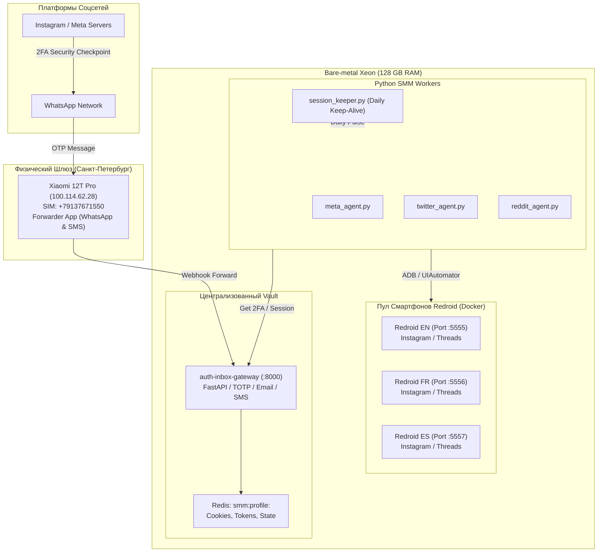

# Экосистема SMM, Виртуальные Телефоны, Персоны и Физический SIM-Шлюз
## Redroid Farm, Persona Lifecycle & Xiaomi 12T Pro WhatsApp/SMS Gateway

---

## 1. Архитектура Мобильного Стека SMM

Социальные сети Meta (Instagram, Threads) и Twitter/X агрессивно детектируют десктопные автоматизированные браузеры через анализ CDP (Chrome DevTools Protocol), WebGL canvas fingerprinting и отсутствие нативных мобильных сенсоров. 

Для надежной, долговечной автоматизации без банов экосистема SmartBet.guru использует гибридный стек:
1. **Пул виртуальных Android-смартфонов Redroid**: Docker-контейнеры на сервере `xeon-srv`, запускающие полноценный Android с нативными клиентами (`com.instagram.android`, `com.instagram.barcelona`, `com.twitter.android`).
2. **Gecko-автоматизация Camoufox / Firefox**: для сценариев веб-парсинга с персистентными профилями (`firefox.launch_persistent_context()`) без CDP-следов.
3. **Физический SIM-шлюз Xiaomi 12T Pro**: мобильный телефон с российской SIM-картой для приёма 2FA OTP кодов через WhatsApp и SMS.
4. **Центральный шлюз `auth-inbox-gateway`**: сервис хранения учетных записей, генерации TOTP и извлечения кодов верификации.

---

## 2. Физический SIM-Шлюз: Xiaomi 12T Pro (+79137671550)

### 2.1. Роль и Назначение
Instagram и Meta при подозрительных входах, смене сетевых IP или периодических проверках безопасности запрашивают подтверждение личности:
- Отправка 6-значного проверочного кода в **WhatsApp** на привязанный доверенный номер.
- Отправка резервного кода по **SMS**.

К системе подключен выделенный физический смартфон:
- **Устройство**: Xiaomi 12T Pro
- **Tailscale IP**: `100.114.62.28` (`xiaomi-12t-pro`)
- **Номер телефона**: `+79137671550`
- **Шлюзовое приложение**: На смартфоне развернут агент автоматической пересылки (SMS & WhatsApp Forwarder).
- **Маршрут пересылки**: При поступлении входящего сообщения от Meta/WhatsApp с шаблоном `[0-9]{6}` код немедленно пересылается по локальной сети через HTTP Webhook в `auth-inbox-gateway` (`POST /api/v1/inbox/webhook/sms-whatsapp`), а также дублируется в закрытый служебный Telegram-канал мониторинга.

### 2.2. Поведение Агента при Запросе Кода
1. Агент детектирует экран запроса 2FA (`checkpoint_required` / экран ввода кода в приложении).
2. Агент обращается в `auth-inbox-gateway`:
   - Сначала проверяет текущий TOTP Authenticator: `GET /api/v1/accounts/{id}/totp`.
   - Если требуется код из WhatsApp/SMS: опрашивает `GET /api/v1/inbox/latest-code?phone=79137671550&service=whatsapp&timeout=45`.
3. При получении кода агент вводит его через ADB (`input text <CODE>`) или браузерную форму и подтверждает сессию.

---

## 3. Персоны, Локали и Циркадный Ритм

Каждая персона SmartBet.guru — это полноценный цифровой аналитик со строго изолированной языковой средой:
- **`en.smartbet.guru`**: английский язык, фокус на Английскую Премьер-лигу (EPL), NBA, NFL.
- **`fr.smartbet.guru`**: французский язык, фокус на Ligue 1, французские медиа (L'Équipe). **СТРОЖАЙШИЙ ЗАПРЕТ НА КИРИЛЛИЦУ (Anti-Cyrillic Guard)**.
- **`es.smartbet.guru`**: испанский язык, La Liga, испаноязычные спортивные порталы.
- **`ru.smartbet.guru`**: русский язык, РПЛ, КХЛ, прямой резидентный выход через `ru-proxy`.

### 3.1. Ежедневный Циркадный Ритм (Circadian Rhythm):
- **08:00 – 10:00 (Утреннее пробуждение и прогрев)**: скролл ленты (2–3 мин), просмотр Stories якорных медиа (Tier 1: Opta, Fabrizio Romano, L'Équipe), 1–2 лайка.
- **11:00 – 16:00 (Экспертный контент)**: анализ арбитражных линий сканера, генерация поста с обязательным расчетом **80% гарантированного кэша фрибета** и строгим дисклеймером против лудомании.
- **17:00 – 21:00 (Вечерний нетворкинг)**: чтение веток вечерних матчей, точечные подписки (Tier 2/3) по кривой Безье с интервалами 15–45 секунд.
- **22:00 – 07:00 (Сон и тишина)**: полная остановка активности.

### 3.2. Session Keeper (Защита от Экспайра Сессий):
Раз в 12–24 часа фоновый демон выполняет легковесный запрос профиля персоны через выделенный статический IP (PureVPN / DE-Proxy), сохраняет свежие cookies в Redis (`smm:profile:<persona_id>`) и обновляет токен авторизации. Это предотвращает внезапный сброс авторизации каждые 14–30 дней.
