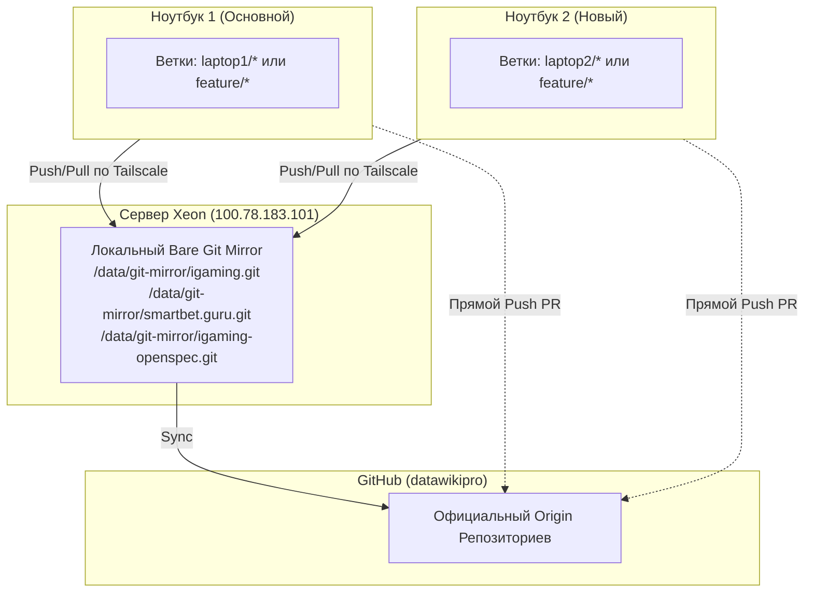

# Enterprise Регламент Разработки: Синхронная Документация, Мульти-Ноутбук и ИИ-Воркеры
## Doc-as-Code Mandate, Multi-Laptop Setup & Parallel AI Agents Protocol

---

## 1. Закон Синхронной Документации (Doc-as-Code Mandate)

### 1.1. Фундаментальный Принцип
> **Код без актуализированной документации считается незавершённым дефектом.**
> Ни один агент (будь то локальный ассистент Antigravity, фоновый воркер Plane в K8s или разработчик-человек) **НЕ ИМЕЕТ ПРАВА** закрывать задачу и переводить её в статус `Завершено`, пока соответствующие изменения не зафиксированы в архитектурной документации и спецификациях OpenSpec.

### 1.2. Матрица Обязательных Обновлений Документации

| Что изменилось в коде | Что ОБЯЗАН обновить агент в том же коммите / PR |
| :--- | :--- |
| **Сетевые маршруты, порты, прокси, K8s Services** | [`docs/architecture/network-and-proxy-mesh.md`](file:///c:/Users/chernousov_a/IdeaProjects/igaming-openspec/docs/architecture/network-and-proxy-mesh.md) и `openspec/specs/k8s-infrastructure/spec.md` |
| **Логика краулера, парсера или маппера БК** | `openspec/specs/crawler-engine/spec.md` и отчет здоровья `docs/crawlers_and_loaders_health_report.md` |
| **Схема БД, таблицы, DDL, миграции** | SQL скрипты миграций и соответствующий раздел спецификации сервиса |
| **Поведение SMM-ботов, шлюзов, персон** | [`docs/architecture/smm-personas-and-sim-gateway.md`](file:///c:/Users/chernousov_a/IdeaProjects/igaming-openspec/docs/architecture/smm-personas-and-sim-gateway.md) и `openspec/specs/social-media-bot/spec.md` |
| **Контракты API, GraphQL, Gateway маршруты** | `openspec/specs/portal-gateway/spec.md` и спецификации фронтенда |
| **Любая функциональная доработка** | Дельта-спецификация в `openspec/changes/<change-id>/` с последующей валидацией `openspec validate --specs` |

### 1.3. Автоматический Гейт Валидации (Pre-Commit & DoD Gate)
Перед завершением работы агент обязан выполнить:
```bash
npx --yes openspec validate --specs
```
Если валидация завершилась с ошибкой — задача блокируется до исправления спецификации.

---

## 2. Разработка на Двух Ноутбуках (Multi-Laptop Setup)

С появлением второго ноутбука разработка делится между двумя физическими рабочими станциями, подключенными к единой сети **Tailscale**.



### 2.1. Быстрый Старт на Втором Ноутбуке (Onboarding в 3 шага):
1. **Подключение к Tailscale**:
   Авторизоваться с ключом `tskey-auth-...` (из глобальных правил). Убедиться, что хост `100.78.183.101` (`xeon-srv`) доступен по пингу.
2. **Клонирование через локальный Git-Mirror на Xeon**:
   ```bash
   git clone ssh://root@100.78.183.101/data/git-mirror/igaming-openspec.git
   git clone ssh://root@100.78.183.101/data/git-mirror/igaming.git
   git clone ssh://root@100.78.183.101/data/git-mirror/smartbet.guru.git
   ```
3. **Настройка Двойного Remote (Fast Mirror + GitHub Origin)**:
   ```bash
   git remote add origin https://github.com/datawikipro/<repo-name>.git
   git remote add xeon ssh://root@100.78.183.101/data/git-mirror/<repo-name>.git
   ```

---

## 3. Протокол Защиты от Коллизий Параллельных Агентов

### 3.1. Git Pre-Flight Check
Перед началом любой задачи агент обязан выполнить:
1. `git status -s` и `git branch --show-current` — убедиться в отсутствии чужих правок в текущей рабочей директории.
2. `git log -n 5 --oneline` — изучить свежие коммиты.
3. `git diff --stat` — зафиксировать файлы, которые сейчас модифицируются.

### 3.2. Строжайшие Запреты:
- ❌ **Категорически запрещено** выполнять деструктивные команды: `git reset --hard`, `git checkout -- .`, `git clean -fd`, `git push --force`.
- ❌ **Запрещено** использовать `git add .` или `git add -A`. Индексировать **только конкретные файлы своей задачи**: `git add <path/to/file>`.
- ❌ **Запрещено** переключать ветки поверх незакоммиченных изменений другого агента.
