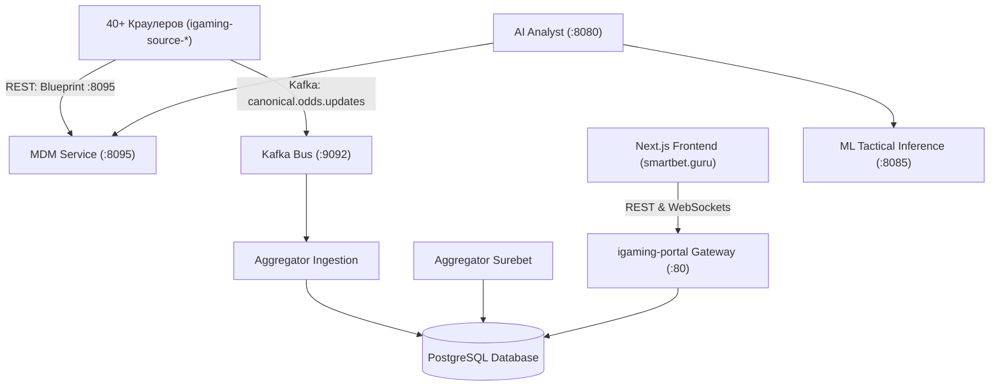

# Архитектура платформы SmartBet.guru

> 🧭 **Актуальные единые источники правды**:
> - 🗺️ [**Полная Карта Межсервисного Взаимодействия (REST, Kafka, DB, Redis)**](file:///c:/Users/chernousov_a/IdeaProjects/igaming/docs/architecture/INTER_SERVICE_COMMUNICATION_MAP.md)
> - 📡 [**Единый Каталог API и Справочник Сервисов**](file:///c:/Users/chernousov_a/IdeaProjects/igaming/docs/API_REFERENCE.md)
> - 🏗️ [**Глубокое погружение в пайплайн (Deep Dive)**](file:///c:/Users/chernousov_a/IdeaProjects/igaming/docs/ARCHITECTURE_AND_PIPELINE_DEEP_DIVE.md)

---

## 1. Схема взаимодействия компонентов

Современная экосистема разделена на изолированные Kubernetes-домены:
1. **`igaming-source`**: Слой сбора данных (40+ краулеров и лоадеров).
2. **`igaming-enrichment`**: Master Data Management (`igaming-mdm-service` :8095), приём данных из Kafka (`igaming-aggregator-ingestion`), сканер вилок (`igaming-aggregator-surebet`), нормализатор названий, SofaScore-мост.
3. **`igaming-api`**: Пользовательский API-шлюз (`igaming-portal` :8081/:80), агрегатор API (`igaming-aggregator-api` :80), фронтенд (`smartbet-guru` :3000, `sportvibe-today` :3000).
4. **`igaming-analytics`**: Квантовый аналитик (`igaming-ai-analyst` :8080), быстрый PyTorch инференс (`igaming-ml-inference` :8085), хранилище витрин ClickHouse (:8123), векторная база Qdrant (:6333), микро-профилирование составов (`igaming-match-vision` :8080).
5. **`igaming-master`**: Шина сообщений Kafka 3.7 (`kafka` :9092) и база пользователей `portal-postgres` (:5432).

Подробные схемы маршрутизации, порты каждого пода и разбор потенциальных сбоев сетевого взаимодействия задокументированы в [**Карте Межсервисного Взаимодействия**](file:///c:/Users/chernousov_a/IdeaProjects/igaming/docs/architecture/INTER_SERVICE_COMMUNICATION_MAP.md).
