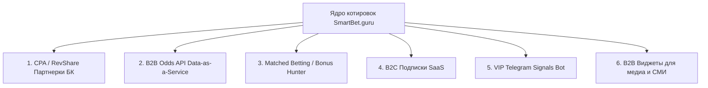

# Аудит международных и латиноамериканских букмекеров: LatAm, Европа, Азия, Африка и монетизация

Документ фиксирует результаты исследования 22 крупнейших международных букмекерских платформ и бирж ставок в Латинской Америке, Европе, Африке и крипто-сегменте, а также многоканальную стратегию монетизации экосистемы **SmartBet.guru**.

---

## 🌐 Сетевая инфраструктура: Маршрутизация через `ru-proxy` (outline-fi)

Маршрутизация международных и латиноамериканских платформ настроена на узле `ru-proxy` (`100.83.113.50:3128`) через шлюз **`outline-fi`**:
- **Egress-сервер**: Нидерланды (Eemshaven, `34.158.66.184:443`, Shadowsocks chacha20-ietf-poly1305 с TLS Client Hello префиксом `%16%03%01%00%00`).
- В `/etc/sing-box/config.json` добавлены доменные суффиксы и ключевые слова для 22 международных БК (Betano, Caliente, Wplay, Unibet, Betdaq, SportyBet, BC.Game и др.).

---

## 📊 Матрица аудита 22 международных букмекеров

| # | Букмекер | Регион | Платформа / Движок | Статус сети | WAF / Защита | Возможность парсинга |
|---|---|---|---|---|---|---|
| **1** | **Betano** | LatAm (Бразилия #1) | Kaizen Gaming | **HTTP 200** (Playwright) | Cloudflare | **Готов (REST API)** |
| **2** | **Caliente** | LatAm (Мексика #1) | Playtech | **HTTP 200** (Playwright) | Cloudflare / Playtech | **Готов (Playtech web_nr API)** |
| **3** | **Wplay** | LatAm (Колумбия #1) | Playtech | **HTTP 200** (244 KB) | Cloudflare | **Готов (REST API / Playtech)** |
| **4** | **Codere** | LatAm / EU (Мексика/Испания)| Playtech / Codere | **HTTP 200** (10.6 KB) | Cloudflare | **Готов (REST API)** |
| **5** | **BetPlay** | LatAm (Колумбия #2) | Kambi | **HTTP 403** (Turnstile) | Cloudflare Turnstile | **Готов (Direct Kambi API)** |
| **6** | **Rushbet** | LatAm (Колумбия/Мексика)| Kambi | **HTTP 403** (Turnstile) | Cloudflare Turnstile | **Готов (Direct Kambi API)** |
| **7** | **EstrelaBet** | LatAm (Бразилия) | Altenar | **ERR_SOCKET** | Altenar IP Geo-block | **Ограничен (Требуется BR IP)** |
| **8** | **Pixbet** | LatAm (Бразилия) | Собственная | **HTTP 403** | Cloudflare Turnstile | **Ограничен (Playwright)** |
| **9** | **Coolbet** | LatAm / Nordics | GAN | **HTTP 403** | Geo-blocking | **Ограничен (Playwright)** |
| **10**| **Superbet** | LatAm / EU | Superbet | **HTTP 451** | CloudFront Geo-block | **Ограничен (EU Residential)** |
| **11**| **Unibet** | Европа (#1 Kambi) | Kambi | **HTTP 200** (Playwright) | Kindred LB | **Готов (Kambi Offering API)** |
| **12**| **Tipico** | Европа (Германия/Австрия #1)| Tipico | **HTTP 200** (364 KB) | Akamai NetStorage | **Готов (REST API)** |
| **13**| **Betdaq** | Европа (Биржа ставок UK/IE) | Betdaq P2P | **HTTP 200** (131 KB) | Cloudflare | **Готов (Биржевой Orderbook)** |
| **14**| **Matchbook** | Европа (Биржа ставок UK) | Matchbook P2P | **HTTP 403** | Cloudflare Turnstile | **Готов (Developer API Key)** |
| **15**| **Smarkets** | Европа (Биржа ставок UK) | Smarkets P2P | **SSL Reset** | TLS Fingerprint | **Готов (Smarkets Open API)** |
| **16**| **Sisal** | Европа (Италия #1) | Flutter | **Timeout** | Akamai Geo-block | **Ограничен (IT Proxy)** |
| **17**| **Snai** | Европа (Италия #2) | Playtech | **Timeout** | Akamai Geo-block | **Ограничен (IT Proxy)** |
| **18**| **Betway** | Global / EU | Super Group | **Timeout** | Cloudflare | **Ограничен (Playwright)** |
| **19**| **SportyBet** | Африка (Нигерия/Кения #1) | Sporty Group | **HTTP 202** (41 API reqs) | AWS WAF | **Готов (REST API)** |
| **20**| **Bet9ja** | Африка (Нигерия #2) | Betradar | **HTTP 403** | Akamai GHost | **Ограничен (NG Proxy)** |
| **21**| **Stake.com** | Global Crypto (#1 в мире) | Easygo | **HTTP 403** (Turnstile) | Cloudflare Turnstile | **Ограничен (Playwright)** |
| **22**| **BC.Game** | Global Crypto | BC.Game | **HTTP 200** (13.1 KB) | Cloudflare | **Готов (WebSocket / API)** |

---

## 🏆 Ключевые технологические находки

1. **Betano (Бразилия / Kaizen Gaming)**:
   - Открывается в Playwright Chromium с кодом `HTTP 200`.
   - Крупнейший букмекер Бразилии с астрономическим объемом ставок на футбол.
   - Стандартный JSON API структуры событий и котировок.

2. **Caliente и Wplay (Мексика и Колумбия / Playtech Engine)**:
   - Оба букмекера работают на платформе Playtech Sportsbook.
   - Эндпоинт `https://sports.caliente.mx/web_nr?key=...` отдает события и коэффициенты через легковесный JSON протокол без тяжелого рендеринга.
   - Реализация одного Playtech-адаптера мгновенно покрывает Caliente (Мексика), Wplay (Колумбия) и Codere.

3. **Kambi в Латинской Америке (BetPlay и Rushbet)**:
   - Главные букмекеры Колумбии работают на движке **Kambi**, идентичном европейскому Unibet и американскому BetRivers.
   - Прямые запросы к `kambi.com/offering/v2018/...` с соответствующим `channel_id` обходят Cloudflare Turnstile веб-морды.

4. **Европейская биржа ставок Betdaq (`betdaq.com`)**:
   - Открывается с кодом `HTTP 200` (131 КБ).
   - Биржа ставок со стаканами Back/Lay и комиссией 2% — идеальный партнер для создания вилок против европейских и латиноамериканских рекреационных БК.

5. **SportyBet (Африка #1)**:
   - Открывается с кодом `HTTP 202`, отдавая 41 внутренний API-запрос на котировки.
   - Высокомаржинальный рынок с частыми задержками обновления линий.

---

## 💰 Многоканальная стратегия монетизации агрегатора

SmartBet.guru монетизируется не только подписками B2C, а диверсифицированной экосистемой из 6 направлений:

### 1. CPA и RevShare партнерки (Главный источник сверхприбыли)
* **Механика**: В карточке вилки пользователь видит кнопки быстрой ставки: «Поставить на Betano» / «Поставить на Bovada». В кнопки вшиты партнерские ссылки SmartBet.guru.
* **Выплаты букмекеров**:
  * США: **$150 – $350** за первый депозит (FTD).
  * Европа: **$80 – $150** за депозит (или 35–45% RevShare).
  * LatAm (Бразилия/Мексика): **$30 – $70** за депозит.
* **Преимущество**: Монетизирует 100% бесплатного поискового трафика, даже тех, кто никогда не купит платную подписку.

### 2. B2B Odds API (Продажа данных по подписке)
* Продажа сырых данных и котировок (JSON / WebSocket) стартапам, капперам, аналитическим сайтам и арбитражным синдикатам:
  * Базовый доступ: $49/мес.
  * Pro доступ (все лиги, до 100k запросов): $249/мес.
  * Realtime WebSocket Stream без задержек: $799 – $1,200/мес.

### 3. Matched Betting / Bonus Hunter Tool
* Калькулятор гарантированного перевода приветственных бонусов и фрибетов в чистые наличные (70–85% от номинала) за счет встречной ставки на бирже (Betfair/Betdaq/Novig).
* Привлекает широкую аудиторию любителей легкого заработка без риска (масс-маркет).

### 4. B2C SaaS Подписка на портале
* Free: вилки до 5.0% (SEO-магнит).
* Premium: $49 – $99/мес (безлимитные вилки, Live, коридоры, +EV).
* Pro Trader: $199/мес (биржевые стаканы, микро-беттинг, мгновенный пуш).

### 5. Telegram VIP Signals Bot
* Мгновенные пуш-уведомления о появлении жирных вилок (>7%) и валуев (+EV) прямо в мессенджер с оплатой через Telegram Stars или USDT ($29–$49/мес).

### 6. Встраиваемые White-label виджеты
* Предоставление интерактивных таблиц «Где выше коэффициент» спортивным медиа и блогерам с распределением партнерского дохода (RevShare split).
