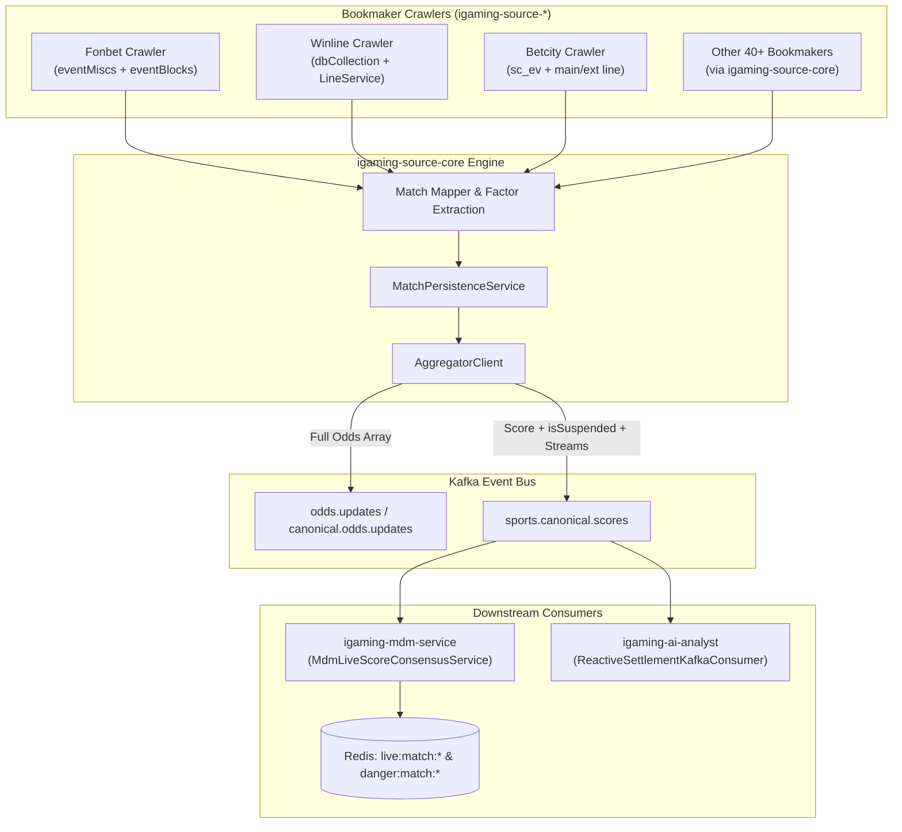

# Design: Bookmakers Real-Time Scores, Suspensions, and Indicators Pipeline

## 1. Architecture Diagram



## 2. DTO Specifications

### 2.1 `CanonicalLiveScoreDto` Extensions
```java
public class CanonicalLiveScoreDto implements Serializable {
    // Existing fields
    private Long matchId;
    private String sourceCode;        // e.g. "fon-bet-ru", "winline", "betcity"
    private String externalEventId;
    private String sport;
    private MatchStatus status;
    private Integer score1;
    private Integer score2;
    private Integer regularScore1;
    private Integer regularScore2;
    private Integer elapsedSeconds;
    private String displayTimer;
    private List<PeriodScoreDto> periods;
    private Long timestamp;

    // New Indicators
    private Boolean isSuspended;       // true when bookmaker locks the markets
    private String dangerStatus;      // e.g. "NORMAL", "SUSPENDED", "DANGER_ATTACK", "PENALTY_VAR"
    private Boolean hasBroadcast;     // true when live video is available
    private String broadcastUrl;      // direct HLS .m3u8 or iframe embed URL
    private Integer corners1;
    private Integer corners2;
    private Integer yellowCards1;
    private Integer yellowCards2;
    private Integer redCards1;
    private Integer redCards2;
}
```

### 2.2 `OddsUpdateRequest` Extensions
```java
public class OddsUpdateRequest {
    // Existing fields: bookmaker, externalEventId, sportName, team1, team2, score1, score2, timer, isLive, odds...
    
    // New Indicators:
    private Boolean isSuspended;
    private String dangerStatus;
    private Boolean hasBroadcast;
    private String broadcastUrl;
    private Integer corners1;
    private Integer corners2;
    private Integer yellowCards1;
    private Integer yellowCards2;
    private Integer redCards1;
    private Integer redCards2;
}
```

## 3. Core Engine Implementation (`igaming-source-core`)

In `AggregatorClient.java`:
1. Inject `KafkaTemplate<String, Object> genericKafkaTemplate` or dedicated `KafkaTemplate<String, CanonicalLiveScoreDto>`.
2. Configure topic: `@Value("${app.kafka.topics.canonical-scores:sports.canonical.scores}") private String canonicalScoresTopic;`
3. Method `publishLiveScoreEvent(OddsUpdateRequest request, Long resolvedMatchId)`:
   - Evaluates whether the request contains live telemetry (`Boolean.TRUE.equals(request.getIsLive()) && (request.getScore1() != null || request.getScore2() != null || Boolean.TRUE.equals(request.getIsSuspended()) || Boolean.TRUE.equals(request.getHasBroadcast()))`).
   - If true, constructs `CanonicalLiveScoreDto` and dispatches to `sports.canonical.scores` with key `resolvedMatchId != null ? String.valueOf(resolvedMatchId) : (request.getBookmaker() + ":" + request.getExternalEventId())`.

## 4. MDM & Redis Consensus Updates

In `MdmLiveScoreConsensusService.java`:
1. When receiving a live score from a bookmaker source:
   - Compares with stored Redis state.
   - If bookmaker score is ahead of current or updates timer monotonically, updates `live:match:<id>`.
2. When receiving `isSuspended == true`:
   - Sets Redis key `danger:match:<matchId>` with TTL = 15 seconds:
     `{"danger": true, "source": "fon-bet-ru", "timestamp": 1729000000, "status": "SUSPENDED"}`
   - When markets reopen (`isSuspended == false`), deletes `danger:match:<matchId>`.
