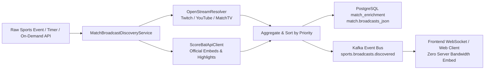

# Design: [aggregator-enrichment] Реактивная публикация видеотрансляций в Kafka топик sports.broadcasts.discovered

## Architecture Overview
The video broadcast discovery mechanism identifies embeddable players and live streams (Twitch, YouTube, ScoreBat, Match TV) for live and upcoming matches and emits events immediately to the frontend event bus via Apache Kafka.

## Zero Server Bandwidth Guarantee
No media bytes are proxied through server infrastructure. Only player metadata, channel names, language flags, priority scores, and iframe embed URLs (e.g. `https://player.twitch.tv/?channel=...`, `https://www.youtube-nocookie.com/embed/...`, `https://www.scorebat.com/embed/v/...`) are transmitted. Client browsers instantiate embed players directly from original content delivery networks.

## Components & Changes

### 1. `KafkaProducerConfig`
Configures `KafkaTemplate<String, Object>` with `StringSerializer` for keys and `JsonSerializer` for values.
Disables type info headers (`JsonSerializer.ADD_TYPE_INFO_HEADERS = false`) for seamless cross-service JSON interoperability.

### 2. `MatchBroadcastDiscoveryService`
- Injects `KafkaTemplate<String, Object>` and resolves `@Value("${app.kafka.topics.broadcasts-discovered:sports.broadcasts.discovered}")`.
- In `enrichMatchStreams(Match match)`:
  - Resolves streams from `OpenStreamResolver` and `ScoreBatApiClient`.
  - Sets `matchId` on each stream.
  - Compares with existing `match.broadcasts_json`.
  - Saves to database.
  - If newly discovered or updated, dispatches each `MatchBroadcastDto` event to Kafka topic `sports.broadcasts.discovered`.
- Provides `discoverBroadcastsForMatch(Long matchId)` for reactive on-demand resolution.
- Provides `onRawEventReceived(SofaRawEventDto event)` for instant reactive triggers upon receiving live score ticks without waiting for the 5-minute cron.

### 3. `SportsRawKafkaConsumer`
- Listens to `sports.raw.sofascore`.
- In addition to triggering `teamDnaEngineService.processRawEvent(event)`, invokes `matchBroadcastDiscoveryService.onRawEventReceived(event)` for zero-latency broadcast detection.

### 4. `StoryboardController`
- Exposes:
  - `POST /api/matches/{matchId}/broadcasts/discover`: Triggers live discovery and immediate event emission.
  - `GET /api/matches/{matchId}/broadcasts`: Retrieves current broadcast streams.
