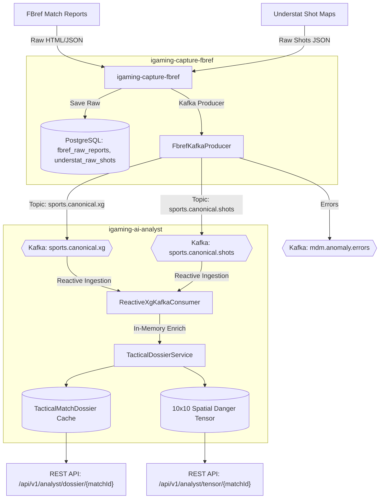

# Architectural Design: [capture-fbref] Реализовать Kafka-стриминг xG и shot maps в топики sports.canonical.xg и sports.canonical.shots

## Context
Plane Task ID: `48a83be3-da4b-434e-b41d-38d625c5ffe3`
Target Module: `monorepo` (modules: `igaming-dto`, `igaming-capture-fbref`, `igaming-ai-analyst`)

Ранее сервис `igaming-capture-fbref` сохранял продвинутую статистику FBref (xG, xAG, SCA, GCA, npxG, прогрессивные передачи/проходы) и карты ударов Understat (x, y координаты, тип удара, ситуация) исключительно в локальные таблицы PostgreSQL (`fbref_raw_reports`, `understat_raw_shots`). В Kafka отправлялись только сообщения об аномалиях в `mdm.anomaly.errors`.

Для реактивного обогащения досье матчей и построения тактических пространственных тензоров без тяжелых SQL-джойнов реализован Kafka-стриминг в канонические топики экосистемы:
- `sports.canonical.xg`
- `sports.canonical.shots`

## Architecture & Components

### 1. Канонический слой данных (`igaming-dto`)
- **`CanonicalMatchXgDto`**: Канонический DTO продвинутой xG-статистики FBref:
  - Идентификаторы: `match_id`, `external_match_id`, `match_url`, `competition`, `season`, `match_week`, `match_date`.
  - Командные агрегаты: `home_xg`, `away_xg`, `home_xag`, `away_xag`, `home_sca`, `away_sca`, `home_gca`, `away_gca`, `home_npxg`, `away_npxg`, `home_prg_p`, `away_prg_p`, `home_prg_c`, `away_prg_c`.
  - Детализация по игрокам (`PlayerXgStatsDto`): голы, ассисты, xG, npxG, xAG, SCA, GCA, key passes, progressive carries.
- **`CanonicalShotMapDto`**: Канонический DTO пространственных карт ударов Understat:
  - Заголовок матча: `match_id`, `league`, `season`, `home_team`, `away_team`, `home_xg`, `away_xg`.
  - Детализация ударов (`CanonicalShotDetailDto`): `shot_id`, `minute`, `result` (Goal, SavedShot, etc.), `x` (0.0–1.0), `y` (0.0–1.0), `xg`, `player`, `team_side` ("h"/"a"), `situation` (OpenPlay, SetPiece, Penalty), `shot_type`, `last_action`.

### 2. Сервис сбора данных (`igaming-capture-fbref`)
- Порт: 3045
- База данных: PostgreSQL `fbref_capture` через K8s DNS `igaming-capture-fbref-db` с неблокирующим пулом HikariCP (`initialization-fail-timeout=0`, `connection-timeout=5000`).
- JPA Сущности:
  - `FbrefRawReport` (`fbref_raw_reports`)
  - `UnderstatRawShot` (`understat_raw_shots`)
- Kafka Producer:
  - `publishCanonicalXg(CanonicalMatchXgDto)` $\rightarrow$ `sports.canonical.xg`
  - `publishCanonicalShotMap(CanonicalShotMapDto)` $\rightarrow$ `sports.canonical.shots`
  - `publishAnomaly(matchId, errorType, details)` $\rightarrow$ `mdm.anomaly.errors`
- Ingestion Service: `FbrefIngestionService` осуществляет атомарное сохранение сырого отчета и моментальную публикацию в Kafka.

### 3. Реактивный аналитический модуль (`igaming-ai-analyst`)
- Порт: 3046
- `ReactiveXgKafkaConsumer`:
  - Слушает топик `sports.canonical.xg` (consumer group: `igaming-ai-analyst-group`)
  - Слушает топик `sports.canonical.shots`
- `TacticalDossierService`:
  - Реактивное обогащение `TacticalMatchDossier` в памяти без SQL-джойнов: расчет xG Differential, эффективности реализации (Shot Conversion Rate), классификация атакующего доминирования (`HOME_ATTACK_DOMINANCE`, `CONTESTED_PARITY`, `OVERPERFORMING_FINISHING`).
  - Построение пространственного тензора `TacticalTensor`: 10x10 сетка плотности опасности ударов на футбольном поле, дифференциация опасных зон (`SIX_YARD_BOX`, `PENALTY_BOX`, `LONG_RANGE`, `FLANKS`, `CENTRAL_CHANNEL`), расчет вектора давления `[left, central, right, depth]`.

## Data Flow Diagram

