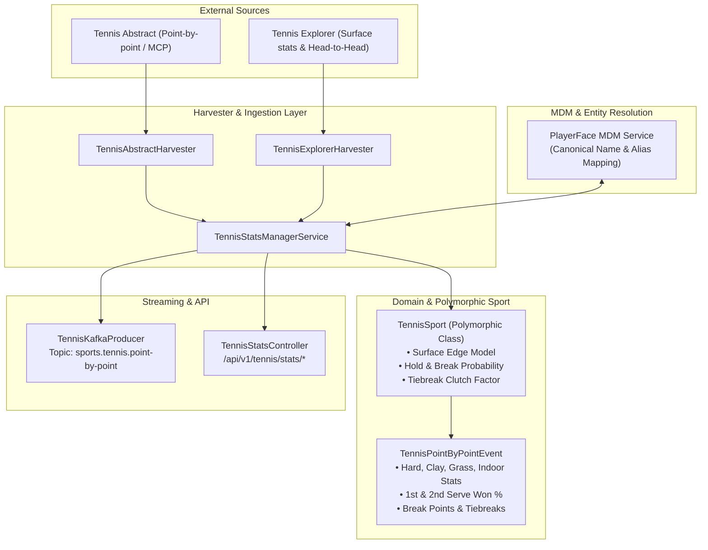

# Technical Design: [capture-tennis-deep] Углубленный point-by-point сбор теннисной статистики (Tennis Abstract)

## 1. Context and Architectural Goals
In tennis betting modeling and quantitative edge evaluation, generic aggregate win-rates fail to capture court-level dynamics. As established in the polymorphic `TennisSport` design, court surfaces (Hard, Clay, Grass, Indoor) dictate rally length, ball bounce speed, and break probability.

This component implements deep point-by-point statistical harvesting from **Tennis Abstract** (Match Charting Project data) and **Tennis Explorer**, computing surface-segregated performance metrics and streaming them via Kafka topic `sports.tennis.point-by-point` with MDM player identification.

## 2. Component Architecture

## 3. Data Model Hierarchy
- `TennisSurface`: `HARD`, `CLAY`, `GRASS`, `INDOOR_HARD` (indoor).
- `PointByPointServeStats`:
  - `firstServeInPct` (% попадания 1-й подачи)
  - `firstServeWonPct` (% выигрыша очков на 1-й подаче)
  - `secondServeWonPct` (% выигрыша очков на 2-й подаче)
  - `acePct`, `doubleFaultPct`
  - `serviceGamesWonPct` (Hold %)
- `PointByPointReturnStats`:
  - `firstServeReturnWonPct` (% выигрыша очков на приеме 1-й подачи)
  - `secondServeReturnWonPct` (% выигрыша очков на приеме 2-й подачи)
  - `breakPointConversionPct` (% реализации брейк-поинтов)
  - `breakPointsWon`, `breakPointsTotal`
  - `returnGamesWonPct` (Break %)
- `TiebreakStats`:
  - `tiebreaksPlayed`, `tiebreaksWon`, `tiebreakWinPct`
- `TennisSurfaceStats`:
  - Surface descriptor, match sample count, serve stats, return stats, tiebreak stats.
- `TennisPointByPointEvent`:
  - MDM player ID, canonical name, tour (`ATP` / `WTA`), ranking, surface map, captured timestamp.

## 4. Kafka Streaming
- Topic: `sports.tennis.point-by-point`
- Partitioning: Keyed by canonical MDM player name or ID.
- Resilience: Non-blocking async publish with error logging, allowing standalone execution even during transient broker downtimes.
