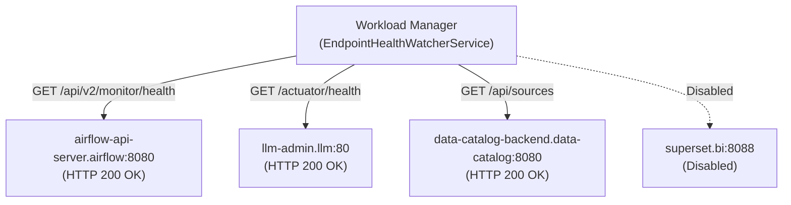

# Design: [accounts] Исправить health check эндпоинты в EndpointHealthWatcherService (workload-manager)

## Context
Plane Task ID: `c64cd993-210e-4548-a1b1-31b4a1e0ad79`

Сервис `accounts/workload-manager` (`igaming-k8s-workload-manager`) выполняет периодический мониторинг здоровья критических сервисов инфраструктуры (`EndpointHealthWatcherService`) и при повторяющихся сбоях (3 подряд) инициирует rolling restart деплойментов.

В Airflow 3, LLM Admin и Data Catalog обновились пути проверок здоровья, из-за чего сервис ошибочно считал здоровые сервисы упавшими и отправлял их в рестарт каждые 15 минут.

## Decisions

### Decision 1: Актуализация эндпоинтов проверок здоровья (Endpoint URL Correction)
- **Airflow API Server**:
  - Устаревший путь: `/health` (в Airflow 3 возвращает `404 Not Found: Moved in Airflow 3. Please change config to check /api/v2/monitor/health`).
  - Актуальный эндпоинт: `http://airflow-api-server.airflow.svc.cluster.local:8080/api/v2/monitor/health` (HTTP 200 OK, JSON со статусами `metadatabase`, `scheduler`).
- **LLM Admin**:
  - Устаревший путь: `/` (Spring Boot возвращает `404 Not Found`).
  - Актуальный эндпоинт: `http://llm-admin.llm.svc.cluster.local:80/actuator/health` (HTTP 200 OK, Spring Boot Actuator Health).
- **Data Catalog Backend**:
  - Устаревший путь: `/actuator/health` (возвращает `404 Not Found: No static resource actuator/health`).
  - Актуальный эндпоинт: `http://data-catalog-backend.data-catalog.svc.cluster.local:8080/api/sources` (HTTP 200 OK, легковесный каталог источников).
- **Superset**:
  - Флаги: `enabled: false`, `auto-restart: false` для предотвращения ложных алертов и рестартов, так как superset в namespace `bi` временно выключен.

### Decision 2: Конфигурация и отказоустойчивость
- Все целевые эндпоинты настроены как в конфигурации `application.yml` и `application.properties`, так и в значениях по умолчанию `getDefaultTargets()` в `EndpointHealthWatcherService.java`.
- Реализован класс свойств `HealthWatcherProperties` с префиксом `health-watcher`.
- Контроллер `WorkloadController` расширен эндпоинтами:
  - `GET /api/v1/workload/health-watcher/states` — просмотр текущего состояния проверок всех сервисов.
  - `POST /api/v1/workload/health-watcher/check` — принудительный запуск цикла проверок.
- Добавлен юнит-тест `EndpointHealthWatcherServiceTest` для валидации корректности всех путей и контрактов.

## Architecture & Data Flow

