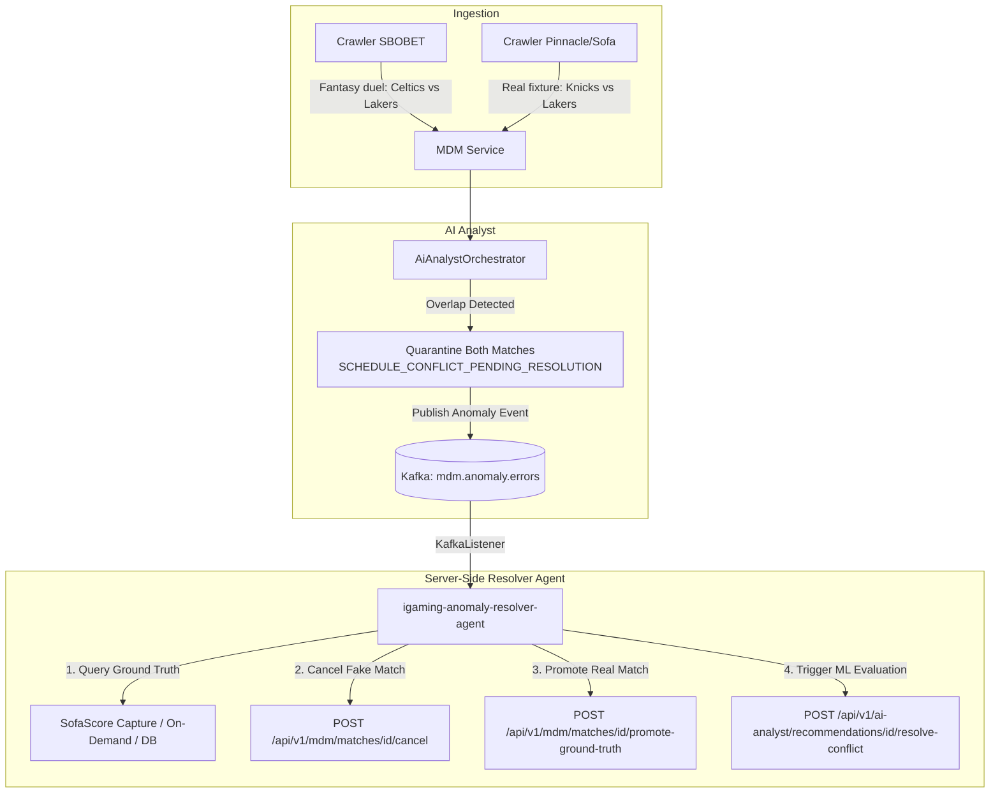

# Design: Server-Side Anomaly-Resolver Agent & Conflict Quarantine Pipeline

## Architecture Overview

## Detailed Components

### 1. Collision Quarantine in `AiAnalystOrchestrator`
- Check team overlap within `sport.getMinimumMatchIntervalMinutes()`.
- If a match has an overlapping team in another active recommendation:
  - Do NOT set `result_status = 'CANCELLED'`.
  - Set `evaluation_stage = 'SCHEDULE_CONFLICT_PENDING_RESOLUTION'`.
  - Set `conviction_tier = 'PASS'`, `recommended_odd = 1.0`, `ev = 0.0`.
  - If existing recommendation is `PENDING`, set its stage to `SCHEDULE_CONFLICT_PENDING_RESOLUTION` to prevent automated bot betting while under investigation.
  - Construct `UnmappedAnomalyEvent`:
    - `entityType`: `"SCHEDULE_COLLISION"`
    - `externalSystemCode`: `"AI_ANALYST"`
    - `rawKey`: `matchId + ":" + existing.getId()`
    - `rawName`: `conflictTeam`
    - `rawCategory`: `t1 + " vs " + t2 + " | " + existing.getTeam1Name() + " vs " + existing.getTeam2Name()`
    - `rawParentKey`: `sport.getSlug()`
    - `details`: JSON payload with match details (leagues, start times, IDs).
  - Submit event to Kafka topic `mdm.anomaly.errors` via `AnomalyReportingService` or MDM REST endpoint.

### 2. MDM Match Management Endpoints
- `POST /api/v1/mdm/matches/{id}/cancel`:
  - Updates `MdmMatch.status = 'CANCELLED'`.
  - Clears active odds / suppresses downstream syndicate betting.
- `POST /api/v1/mdm/matches/{id}/promote-ground-truth`:
  - Sets `MdmMatch.sourceOrigin = 'SOFASCORE'`.
  - Accepts optional `sofascoreId`.
  - Sets `MdmMatch.status = 'SCHEDULED'`.

### 3. AI Analyst Conflict Resolution Endpoint
- `POST /api/v1/ai-analyst/recommendations/{id}/resolve-conflict`:
  - Query params: `action` (`CANCEL` | `PROMOTE`), `reason` (`String`).
  - If `CANCEL`:
    - Marks recommendation `evaluation_stage = 'CANCELLED_SYNTHETIC_COLLISION'`, `result_status = 'CANCELLED'`, `conviction_tier = 'PASS'`.
  - If `PROMOTE`:
    - Clears conflict stage (`evaluation_stage = 'EVALUATED'`), triggers immediate ML evaluation via `orchestrator.evaluateMatch(id)`.

### 4. `igaming-anomaly-resolver-agent` Architecture
- Standalone Spring Boot microservice.
- Dependencies: `spring-kafka`, `spring-boot-starter-web`, `spring-boot-starter-actuator`, `igaming-dto`.
- Containerization: Jib to `100.78.183.101:30500/igaming-anomaly-resolver-agent:latest`.
- Kubernetes: Deployment in `igaming-enrichment` or `igaming-analytics` namespace with 1 replica, `nodeAffinity` to `xeon-srv`.
- Ground Truth Heuristics:
  1. **SofaScore Event Match**: If one match has a confirmed `sofascoreId` or exists in `sofascore_raw_events`, it is ground truth.
  2. **League Name Audit**: If one match is in `League \d+` or contains `fantasy|synthetic|мифическ|cyber`, while the other is in a canonical league (e.g. `NBA`, `Euroleague`, `Premier League`), the canonical league wins.
  3. **Bookmaker Consensus Count**: If one match is offered by 5+ bookmakers and the other is offered by only 1 bookmaker with synthetic odds, the multi-bookmaker match wins.
- Remediation Execution:
  - Invokes MDM cancel on the loser.
  - Invokes Analyst cancel on the loser.
  - Invokes MDM promote on the winner.
  - Invokes Analyst promote & re-evaluate on the winner.
