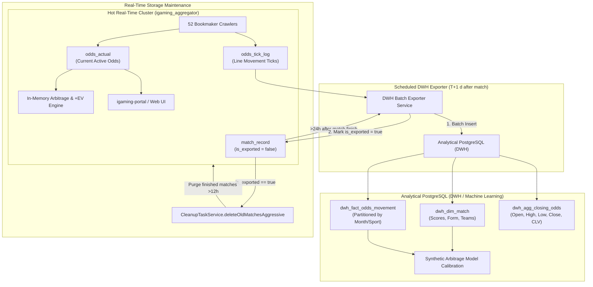

# Design: Synthetic Arbitrage & Predictive Fair-Odds Analytics

## Architecture Overview



## Mathematical Model

1. **De-marginalization (Shin's Method / Proportional)**:
   Given best market odds $K_1, K_X, K_2$:
   $$S = \sum_{i} \frac{1}{K_i}$$
   $$P_{\text{implied}, i} = \frac{1 / K_i}{S}$$

2. **Closing Line Value (CLV) & Sharp Bookmaker Weighting**:
   Pinnacle and Betfair closing lines from the analytical DWH provide the benchmark zero-margin probabilities:
   $$P_{\text{sharp}, i} = \text{Demarginalize}(K_{\text{pinnacle}, i})$$

3. **Form & Momentum Adjustment**:
   Adjust probabilities using historical data, recent 5 matches, and pitch disparities:
   $$W_{\text{form}, 1} = \frac{\text{Wins}_1 + 0.5 \times \text{Draws}_1}{\text{TotalGames}_1}$$
   $$P_{\text{model}, 1} = w_1 P_{\text{sharp}, 1} + w_2 P_{\text{implied}, 1} + w_3 W_{\text{form}, 1}$$

4. **Synthetic Arbitrage Yield**:
   $$\text{Yield} = \max\left(0, \left( K_{1, \max} \times P_{\text{model}, 1} \right) - 1\right) \times 100\%$$

## Dual-Tier Database Schemas

### 1. Real-Time PostgreSQL (`igaming_aggregator`)

- `odds_tick_log`:
  ```sql
  CREATE TABLE odds_tick_log (
      id BIGSERIAL PRIMARY KEY,
      match_id BIGINT NOT NULL,
      bet_source_id BIGINT NOT NULL,
      bookmaker VARCHAR(50) NOT NULL,
      odds_type_id BIGINT NOT NULL,
      param NUMERIC(6, 2),
      value NUMERIC(8, 3) NOT NULL,
      recorded_at TIMESTAMP WITH TIME ZONE DEFAULT CURRENT_TIMESTAMP
  );
  CREATE INDEX idx_odds_tick_match_time ON odds_tick_log (match_id, recorded_at);
  ```

- `match_record`:
  Existing table with `is_exported BOOLEAN DEFAULT FALSE`.

### 2. Analytical PostgreSQL (`igaming_analytics` DWH)

- `dwh_dim_match`:
  ```sql
  CREATE TABLE dwh_dim_match (
      match_id BIGINT PRIMARY KEY,
      sport_name VARCHAR(100),
      league_id BIGINT,
      league_name VARCHAR(255),
      team1_id BIGINT,
      team1_name VARCHAR(255),
      team2_id BIGINT,
      team2_name VARCHAR(255),
      start_time TIMESTAMP WITH TIME ZONE,
      final_score1 INT,
      final_score2 INT,
      source_count INT,
      exported_at TIMESTAMP WITH TIME ZONE DEFAULT CURRENT_TIMESTAMP
  );
  ```

- `dwh_fact_odds_movement` (Partitioned by range on `recorded_at`):
  ```sql
  CREATE TABLE dwh_fact_odds_movement (
      id BIGSERIAL,
      match_id BIGINT NOT NULL,
      bookmaker VARCHAR(50) NOT NULL,
      odds_type_code VARCHAR(50) NOT NULL,
      param NUMERIC(6, 2),
      value NUMERIC(8, 3) NOT NULL,
      recorded_at TIMESTAMP WITH TIME ZONE NOT NULL,
      PRIMARY KEY (id, recorded_at)
  ) PARTITION BY RANGE (recorded_at);
  ```

- `dwh_agg_closing_odds`:
  ```sql
  CREATE TABLE dwh_agg_closing_odds (
      match_id BIGINT NOT NULL,
      bookmaker VARCHAR(50) NOT NULL,
      odds_type_code VARCHAR(50) NOT NULL,
      open_value NUMERIC(8, 3),
      high_value NUMERIC(8, 3),
      low_value NUMERIC(8, 3),
      close_value NUMERIC(8, 3),
      clv_diff_pct NUMERIC(6, 2),
      PRIMARY KEY (match_id, bookmaker, odds_type_code)
  );
  ```

## ETL Lifecycle (T+1 Day Export)

1. **Trigger Condition**:
   Cron job executes every hour:
   ```sql
   SELECT id FROM match_record 
   WHERE start_time < (EXTRACT(EPOCH FROM NOW() - INTERVAL '24 hours') * 1000)
     AND is_exported = false
     AND (final_score1 IS NOT NULL OR match_result IS NOT NULL OR is_live = false);
   ```

2. **Batch Export**:
   - Extract match metadata $\rightarrow$ Insert to `dwh_dim_match`.
   - Extract all ticks from `odds_tick_log` $\rightarrow$ Copy to `dwh_fact_odds_movement`.
   - Compute Open/Close/High/Low and Pinnacle CLV $\rightarrow$ Insert to `dwh_agg_closing_odds`.

3. **Status Update & Safe Purge**:
   - `UPDATE match_record SET is_exported = true WHERE id IN (:exportedIds);`
   - `DELETE FROM odds_tick_log WHERE match_id IN (:exportedIds);`
   - Scheduled `CleanupTaskService.deleteOldMatchesAggressive` cleans up `match_record` in the real-time DB after the safety threshold, keeping the hot OLTP instance lean and fast.

## UI Component Contract

The UI component in `MatchEnrichmentSection.tsx`:
- Renders in the primary "Аналитика и Форма" tab.
- Displays Favorite and Outsider cards with:
  - Calculated probability (%)
  - Fair odds equivalent ($\frac{100}{P}$)
  - Best market odds available across 52 bookmakers
- Shows the Synthetic Yield Banner with:
  - Estimated yield percentage (e.g. `+12.8%`)
  - Calibration database count
  - Visual status pill: `⚡ В РАЗРАБОТКЕ` (In Development)
- Shows the Historical Line Movement & DWH Archival badge:
  - "Сбор тиков и движения линий: Real-time DB → Экспорт в Analytical DWH (T+1 d)"
  - `ETL RETENTION: 100% TICKS`
